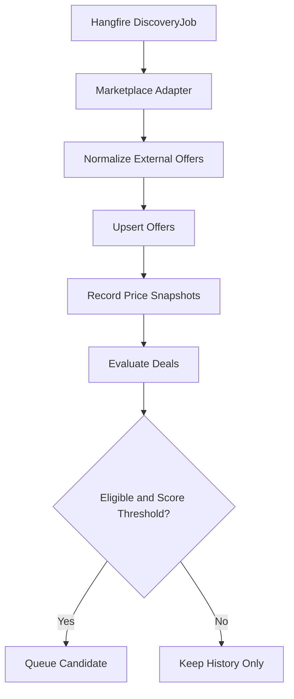

# Achadinhos Engine

> **Technical Design Document (TDD) v1.0**  
> Status: planejamento técnico para implementação  
> Foco: **API ASP.NET Core + workers**, com painel Next.js administrativo simplificado.

## 1. Visão e objetivos

Construir uma plataforma própria que descubra ofertas de marketplaces, normalize os dados, registre preços, avalie a atratividade, gere links de afiliados e publique automaticamente as melhores oportunidades em **um canal Telegram**. O painel existe para configurar, revisar e acompanhar a operação, não para ser um produto de experiência complexa.

**Resultado esperado do MVP:** coletar ofertas reais de uma integração autorizada, classificá-las de maneira explicável, revisar ou agendar publicações e publicar no Telegram com confiabilidade operacional.

### Princípios

1. Confiança do público antes da comissão: desconto anunciado precisa ser defensável.
2. API e workers independentes em runtime, compartilhando domínio e banco.
3. Monólito modular antes de distribuir serviços.
4. Integrações isoladas por adapters; nunca acoplar domínio ao contrato de uma loja.
5. Idempotência e auditabilidade em todos os fluxos de mutação.
6. Respeitar limites técnicos e condições contratuais das APIs. Não pressupor scraping não autorizado.
7. IA é opcional: nenhum dado comercial pode ser inventado por um modelo.

### Fora do escopo inicial

- WhatsApp e múltiplos grupos/canais;
- microserviços, Kafka e Kubernetes;
- comparação confiável entre todas as lojas sem fontes autorizadas;
- recomendação personalizada por usuário final;
- app mobile;
- otimização automatizada de comissões e campanhas sofisticadas.

## 2. Decisões arquiteturais

| Área | Escolha | Justificativa |
| --- | --- | --- |
| Backend | ASP.NET Core 10 / C# | API e processamento robusto, suporte LTS |
| Front administrativo | Next.js + TypeScript | CRUD, filtros, revisão e operação |
| Arquitetura | Monólito modular | Limites claros com baixo overhead |
| Banco | PostgreSQL + EF Core | Integridade, histórico e transações |
| Jobs | Hangfire, com storage persistente compatível | Recorrência, filas e retries |
| Cache | Redis apenas se necessário | Evitar infraestrutura prematura |
| Origem inicial | Shopee Affiliate API, mediante acesso aprovado | Marketplace prioritário para validar negócio |
| Publicação | Telegram Bot API | Integração oficial com canais |
| Infraestrutura | Docker Compose no desenvolvimento, containers em produção | Reprodutibilidade |
| Telemetria | OpenTelemetry, métricas e logs estruturados | Operabilidade |
| IA | Serviço opcional desacoplado | Redação, nunca fonte de fatos |

**Topologia:** `Next.js Admin -> ASP.NET Core API -> PostgreSQL` e `Hangfire Worker -> PostgreSQL + APIs externas (Shopee/Telegram)`. O worker executa Discovery, Evaluation e Publishing. A API recebe comandos e consulta projeções persistidas; não dispara loops longos durante requests HTTP.

## 3. Módulos e responsabilidades

- **Catalog:** identificação canônica dos produtos, categorias e marcas; sem presumir que anúncios em lojas distintas sejam o mesmo SKU.
- **Discovery:** contratos de marketplace, consultas paginadas, normalização, coleta, controle de quotas e sync runs.
- **Pricing:** preço observado, moeda, condições, snapshots e consultas históricas.
- **DealIntelligence:** regras de elegibilidade, scoring versionado, justificativas e níveis de confiança.
- **Affiliates:** geração de links e sub-IDs, validade e rastreabilidade; apenas onde o programa permitir.
- **Publishing:** seleção, revisão, agendamento, validação final, template, entrega e reconciliação.
- **Analytics:** estatísticas de coleta, candidatos, publicações, cliques e comissões quando os dados existirem.
- **Administration:** autenticação, RBAC, configuração de canais, integrações e kill switches.

**Regra de modularidade:** módulos comunicam-se por contratos explícitos/casos de uso. Não permitir escritas arbitrárias nas tabelas de outro módulo.

## 4. Integrações externas

### 4.1 Shopee

Validar primeiro credenciais, autorização, região brasileira, quotas e operações habilitadas. Referência inicial: [Shopee Brasil API Explorer](https://open-api.affiliate.shopee.com.br/explorer). Operações de consultas de produtos/campanhas e geração de links podem depender do programa, versão e permissões da conta; não codificar um endpoint presumido antes de validar o contrato real.

Contrato interno sugerido:

```csharp
public interface IMarketplaceProvider
{
    Task<IReadOnlyList<ExternalOffer>> DiscoverAsync(
        DiscoveryCriteria criteria,
        CancellationToken cancellationToken);

    Task<ExternalOffer?> GetOfferAsync(
        string externalId,
        CancellationToken cancellationToken);

    Task<AffiliateLinkResult> GenerateAffiliateLinkAsync(
        string productUrl,
        string trackingId,
        CancellationToken cancellationToken);
}
```

**ExternalOffer mínimo:** `Provider`, `ExternalOfferId`, `ExternalProductId?`, `SellerId?`, `Title`, `ProductUrl`, `ImageUrl?`, `Currency`, `CurrentPrice?`, `OriginalPrice?`, `Availability?`, `Category?`, `CollectedAt`, `RawPayload`, `DataConfidence`. Adicionar outros campos apenas conforme API real.

**Controles:** autenticação/assinatura conforme documentação vigente, paginação, rate limiting, retries controlados, backoff com jitter, circuit breaker e logs sem credenciais. Persistir raw payload para auditoria e diagnóstico, com política de retenção.

### 4.2 Telegram

Referência: [Telegram Bot API](https://core.telegram.org/bots/api).

1. Criar bot via BotFather.
2. Criar canal e adicionar bot como administrador com permissão de publicação.
3. Configurar `chat_id` e token por segredo de ambiente.
4. Usar `sendPhoto` quando a imagem for permitida e acessível, ou `sendMessage` como fallback.
5. Associar botão `InlineKeyboardMarkup` ao link de afiliado, sinalizando conteúdo publicitário.
6. Persistir `message_id`, `chat_id`, request/response sanitizados e estado de entrega.
7. Respeitar HTTP 429 e `retry_after`; tratar falhas transitórias e definitivas de forma distinta.

**Importante:** em timeout após envio, Telegram pode ter publicado sem que a resposta tenha chegado. Não reenviar cegamente. Registrar `UnknownDelivery` e exigir reconciliação ou revisão antes de nova tentativa. A API não oferece chave universal de idempotência para `sendMessage`/`sendPhoto`.

## 5. Modelo de dados (PostgreSQL)

Tabelas principais e campos recomendados:

| Tabela | Campos essenciais | Observações |
| --- | --- | --- |
| `marketplaces` | `id`, `code`, `name`, `enabled`, `config_json`, `created_at` | Segredos fora do banco quando possível |
| `products` | `id`, `canonical_name`, `brand`, `category`, `created_at` | Identificação canônica conservadora |
| `offers` | `id`, `marketplace_id`, `product_id?`, `external_offer_id`, `external_seller_id?`, `title`, `product_url`, `image_url?`, `currency`, `current_price?`, `original_price?`, `availability`, `status`, `last_seen_at`, `raw_payload` | Unique por marketplace + external offer |
| `price_snapshots` | `id`, `offer_id`, `price`, `currency`, `price_type`, `coupon_conditions?`, `source`, `captured_at` | Preços observados, não inventados |
| `deal_evaluations` | `id`, `offer_id`, `score`, `confidence`, `score_version`, `eligible`, `reasons_json`, `evaluated_at` | Histórico de decisões |
| `affiliate_links` | `id`, `offer_id`, `tracking_id`, `affiliate_url`, `provider`, `created_at`, `expires_at?` | Não assumir que URL nunca expira |
| `channels` | `id`, `platform`, `external_chat_id`, `name`, `enabled`, `posting_rules_json` | Telegram no MVP |
| `publication_queue` | `id`, `offer_id`, `channel_id`, `campaign_id?`, `scheduled_at`, `status`, `attempt_count`, `lease_until?`, `idempotency_key`, `created_at` | Fila persistente e bloqueios |
| `publications` | `id`, `queue_id`, `offer_id`, `channel_id`, `telegram_message_id?`, `status`, `published_at?`, `error_code?` | Histórico de entregas |
| `integration_runs` | `id`, `provider`, `job_type`, `status`, `started_at`, `finished_at?`, `items_received`, `items_upserted`, `error_summary?` | Diagnóstico e monitoramento |
| `click_events` | `id`, `affiliate_link_id`, `clicked_at`, `referrer?` | Somente se utilizar link de redirect próprio; retenção e LGPD |
| `conversion_reports` | `id`, `provider`, `external_conversion_id?`, `affiliate_link_id?`, `commission`, `currency`, `reported_at` | Somente se programa fornecer relatórios |
| `audit_events` | `id`, `actor`, `action`, `entity_type`, `entity_id`, `metadata_json`, `created_at` | Alterações administrativas |

### Restrições e índices

- `UNIQUE(marketplace_id, external_offer_id)` em `offers`.
- `INDEX(offer_id, captured_at DESC)` em `price_snapshots`.
- `UNIQUE(idempotency_key)` em `publication_queue`.
- Restrição de duplicação comercial por `(channel_id, offer_id, campaign_id)` quando `campaign_id` existir; para campanhas nulas, considerar índice parcial ou chave de negócio explícita.
- Datas: `timestamptz` UTC. Exibição no fuso `America/Sao_Paulo`.
- Dinheiro: `numeric(18,2)` e coluna `currency`; evitar `float/double`.
- `jsonb` para payload externo e explicações, sem substituir campos indexáveis.
- Considerar particionamento/retention para snapshots e click events apenas quando volume justificar.

## 6. Fluxo de coleta



Estratégias configuráveis, condicionadas aos limites oficiais:

| Estratégia | Cadência proposta |
| --- | --- |
| Campanhas em destaque | A cada 1 hora |
| Busca por categorias | A cada 2 horas |
| Watchlist de produtos populares | A cada 30 minutos |
| Revalidação de candidatos | A cada 15–30 minutos |
| Atualização geral de histórico | Diária |

Essas são **propostas**, não quotas garantidas. Ajustar com base na documentação, permissões e telemetria.

A cada execução: criar `integration_run`, buscar por páginas com cursor seguro, validar dados, normalizar, fazer upsert transacional, registrar snapshot se houver observação nova, emitir avaliação e enfileirar candidato elegível. Respostas incompletas não devem apagar informação válida anterior sem política explícita.

## 7. Deal Score e qualidade

Antes do score, aplicar **gates**: URL válida, marketplace habilitado, preço atual conhecido, dados minimamente confiáveis, ausência de bloqueio do vendedor e frescor suficiente.

Score inicial de 0 a 100:

```text
score = 0.35 * H + 0.25 * C + 0.20 * V + 0.10 * D + 0.10 * A

H = vantagem versus histórico verificável
C = competitividade versus outras fontes comparáveis
V = confiança no vendedor
D = demanda/relevância do público
A = atratividade comercial / comissão
```

**Cuidado:** não converter ausência de histórico ou comparação em nota fictícia. Produzir `confidence` e `reasons`; com baixa confiança, encaminhar para revisão e não afirmar desconto histórico.

Política inicial configurável:

- `score >= 85`: elegível para automação *somente* quando confiança e validade estiverem adequadas.
- `70 <= score < 85`: fila de revisão.
- `score < 70`: não publicar automaticamente.
- Limitar frequência por produto, categoria, vendedor e canal.
- Não confundir preço cheio anunciado com preço histórico comprovado.

Esses limiares são heurísticas a validar contra dados reais.

## 8. Máquina de estados de publicação

```text
Candidate -> Approved -> Scheduled -> Preflight -> Sending -> Published
     |           |          |            |           |
     v           v          v            v           v
  Rejected    Cancelled  Cancelled    Cancelled   Failed / UnknownDelivery
```

### Passos

1. Selecionar oferta elegível e reservar item da fila por lease transacional.
2. Revalidar preço e estoque conforme fontes autorizadas; se impossível, aplicar política de idade máxima dos dados e eventual revisão manual.
3. Gerar/recuperar link afiliado com tracking ID.
4. Montar conteúdo somente a partir de fatos conhecidos; indicar publicidade/afiliado.
5. Enviar `sendPhoto` ou `sendMessage`.
6. Persistir resposta, `telegram_message_id`, estado e timestamp.
7. Em erro: classificar retryable/permanent; em entrega ambígua, `UnknownDelivery`.

**Idempotência:** impedir simultaneidade de workers sobre a mesma publicação e repetir apenas ações comprovadamente seguras. `Published` nunca volta para `Sending` por retry automático.

Template ilustrativo:

```text
🔥 OFERTA SELECIONADA

{ProductTitle}
💰 Por {CurrentPrice}
{DiscountEvidenceIfVerified}

🛒 Confira: {AffiliateUrl}
Publicidade: este canal pode receber comissão pela compra.

Preço e disponibilidade sujeitos a alteração.
```

## 9. API REST inicial

| Método e rota | Descrição |
| --- | --- |
| `GET /api/offers` | Lista filtrada e paginada |
| `GET /api/offers/{id}` | Detalhe, avaliação e histórico |
| `POST /api/offers/{id}/evaluate` | Solicita reavaliação |
| `POST /api/offers/{id}/approve` | Aprovação administrativa |
| `POST /api/offers/{id}/reject` | Rejeição justificada |
| `GET /api/publications` | Fila/histórico |
| `POST /api/publications` | Agendar publicação |
| `POST /api/publications/{id}/cancel` | Cancelamento |
| `GET /api/integrations` | Status dos providers |
| `POST /api/integrations/{id}/sync` | Solicita sincronização |
| `GET /api/analytics/overview` | Métricas básicas |
| `GET /health/live` | Liveness |
| `GET /health/ready` | Readiness |

- Proteger endpoints administrativos com autenticação e autorização.
- Documentar OpenAPI, erros padronizados (ProblemDetails), filtros, paginação e `correlation_id`.
- Aplicar idempotency key nos comandos aplicáveis, especialmente criação de publicação.
- Validar input e auditoria em mudanças manuais.

## 10. Painel administrativo mínimo (Next.js)

**Objetivo:** permitir operar a API, não competir com ela em complexidade.

Telas suficientes:

1. **Dashboard:** coletadas, aprovadas, publicadas, falhas e cliques (se mensurados).
2. **Ofertas:** tabela com busca, categoria, score, preço, data e detalhe/histórico.
3. **Revisão:** aprovar, rejeitar e agendar.
4. **Publicações:** fila, entregues, canceladas, falhas e entregas incertas.
5. **Integrações/Configuração:** status da Shopee, Telegram, cron e regras de publicação.

Preferir componentes de tabela/formulários existentes; sem necessidade de design elaborado, SSR complexo ou atualização em tempo real no MVP. Polling controlado é suficiente.

## 11. Estrutura sugerida de repositório

```text
achadinhos-engine/
├── apps/
│   └── admin/                     # Next.js mínimo
├── backend/
│   ├── Achadinhos.Api/
│   ├── Achadinhos.Worker/
│   ├── Achadinhos.Domain/
│   ├── Achadinhos.Application/
│   ├── Achadinhos.Infrastructure/
│   └── Achadinhos.Contracts/
├── tests/
│   ├── UnitTests/
│   ├── IntegrationTests/
│   └── ContractTests/
├── infra/
│   ├── docker/
│   └── compose.yaml
└── docs/
    ├── architecture/
    ├── decisions/
    └── integrations/
```

Ao iniciar, criar solution `.sln`, projetos, referências unidirecionais e migrations. Evitar uma camada `Infrastructure` com regras de negócio. Usar contratos internos que tornem providers substituíveis.

## 12. Segurança, testes e operação

### Segurança

- Secrets em variáveis protegidas/secret manager, nunca em Git ou `appsettings.json` versionado.
- Admin com autenticação e RBAC mínimo (`Admin`, `Reviewer`, `Viewer`).
- Restringir CORS ao domínio do painel; HTTPS em produção.
- Redação de tokens, URLs sensíveis e dados pessoais em logs.
- Controle de taxa dos endpoints e feature flags/kill switch por provider e canal.
- Dados de click tracking mínimos, retenção explícita e conformidade com LGPD.

### Observabilidade

- Logs estruturados com `correlation_id`, `integration_run_id`, `offer_id` e `publication_id`.
- Métricas: taxa de erro do provider, latência, itens importados, candidatos gerados, score por faixa, fila pendente, tempo até publicar, 429, falhas e entregas incertas.
- Alertas: credenciais inválidas, falha prolongada da coleta, backlog excessivo e erro contínuo do Telegram.
- Backups PostgreSQL e restore testado.

### Testes essenciais

- Unitários: score, elegibilidade, templates, transições de estado.
- Contrato: adapters com fixtures sanitizadas das respostas oficiais.
- Integração: EF Core + PostgreSQL real em container, upsert concorrente, migrations.
- Worker: retries, lease, reprocessamento e timeout pós-envio.
- End-to-end: coleta simulada -> aprovação -> publicação em canal Telegram de teste.

## 13. Roadmap sugerido

### Sprint 1 — Foundation + contrato Shopee

- [ ] Monorepo, solution e estrutura de módulos.
- [ ] Docker Compose com PostgreSQL e API/Worker.
- [ ] CI com build, lint e testes.
- [ ] EF Core migrations das entidades núcleo.
- [ ] Auth do painel e OpenAPI.
- [ ] Validar credenciais, quotas e operações efetivamente disponíveis na Shopee Brasil.
- [ ] Implementar provider e testes contratuais.

**Entrega:** primeira coleta real, caso o acesso da API já esteja habilitado.

### Sprint 2 — Discovery + Pricing + Deal Intelligence

- [ ] Hangfire configurado com storage persistente.
- [ ] DiscoveryJob com paginação, limite de requisições e telemetria.
- [ ] Normalização, upsert e deduplicação.
- [ ] Snapshots e histórico de preços.
- [ ] Deal Score v1, elegibilidade, confiança e justificativas.
- [ ] Endpoints de ofertas e reavaliação.

**Entrega:** candidatos classificáveis e consultáveis pela API.

### Sprint 3 — Affiliate + Telegram + Admin básico

- [ ] Geração de links afiliados e tracking.
- [ ] Bot e canal Telegram de teste.
- [ ] Máquina de estados, fila, lease e idempotência.
- [ ] Templates e publicação assistida.
- [ ] CRUD/tabelas Next.js para ofertas e revisão.

**Entrega:** fluxo ponta a ponta com aprovação humana.

### Sprint 4 — Hardening + deploy

- [ ] Revalidação pré-publicação.
- [ ] Rate limit, 429, backoff, circuit breaker e UnknownDelivery.
- [ ] Telemetria, dashboards, alertas e auditoria.
- [ ] Testes E2E, backups e restore.
- [ ] Deploy containerizado e feature flag para publicação automática.
- [ ] Relatórios operacionais simples.

**Entrega:** MVP publicando automaticamente sob regras definidas. As quatro semanas são hipótese de planejamento, sujeita a disponibilidade técnica e credenciais.

## 14. Critérios de aceite do MVP

- [ ] Importar dados reais de uma integração oficialmente autorizada.
- [ ] Coletar periodicamente sem duplicar anúncios.
- [ ] Preservar evidência, origem, condições e horário do preço.
- [ ] Avaliar e justificar cada oferta com confiança conhecida.
- [ ] Gerar links afiliados válidos e rastreáveis quando permitido.
- [ ] Agendar e publicar em um canal do Telegram após aprovação.
- [ ] Bloquear ofertas inválidas, obsoletas ou já publicadas na mesma campanha.
- [ ] Tratar retries e entrega ambígua sem duplicação cega.
- [ ] Consultar resultados e erros no painel.
- [ ] Desligar coleta ou publicação independentemente por configuração.

## 15. Ordem prática para começar a codificar

1. Criar repositório e solution; levantar PostgreSQL localmente.
2. Definir `Offer`, `PriceSnapshot`, `IntegrationRun` e migrations antes do primeiro conector.
3. Implementar `IMarketplaceProvider` e `ShopeeProvider` com fixtures + teste real de autenticação.
4. Criar endpoint interno para rodar descoberta manualmente (disparando job, sem bloquear request).
5. Construir upsert idempotente e coleta persistente.
6. Implementar avaliações e expor consulta de ofertas.
7. Criar fluxo de aprovação + publicação Telegram em ambiente de teste.
8. Somente depois construir o painel Next.js básico.

**Primeira vertical slice recomendada:** `API -> enfileirar DiscoveryJob -> ShopeeProvider -> normalizar -> PostgreSQL -> GET /api/offers`. Esse caminho prova a integração mais arriscada antes de investir tempo no frontend.

## 16. Pendências externas e decisões abertas

- [ ] Conta aprovada no programa de afiliados Shopee e credenciais oficiais.
- [ ] Operações/versões/limites disponíveis para o perfil brasileiro.
- [ ] Definir categorias iniciais e política editorial do canal.
- [ ] Criar bot e canal Telegram de produção/teste.
- [ ] Escolher hospedagem, secret manager e estratégia de backups.
- [ ] Definir se links de clique terão redirect próprio ou apontarão diretamente ao parceiro.
- [ ] Validar os requisitos de divulgação publicitária, termos dos marketplaces e proteção de dados aplicáveis.

## 17. Referências

- [Shopee Brasil API Explorer](https://open-api.affiliate.shopee.com.br/explorer)
- [Telegram Bot API](https://core.telegram.org/bots/api)
- [Microsoft .NET support policy](https://dotnet.microsoft.com/en-us/platform/support/policy/dotnet-core)
- [Hangfire documentation](https://docs.hangfire.io/)
- [EF Core documentation](https://learn.microsoft.com/en-us/ef/core/)
- [PostgreSQL documentation](https://www.postgresql.org/docs/)

---

**Nota de engenharia:** este documento é a especificação inicial, não comprovação de contratos de afiliados habilitados. Ao obter credenciais, atualizar as seções de integração com os schemas reais, limites e exemplos sanitizados; registrar decisões posteriores em ADRs.
